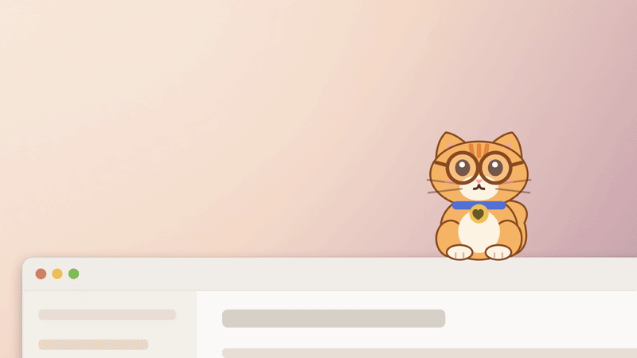
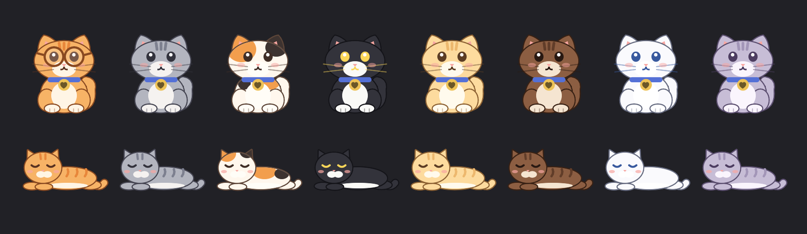
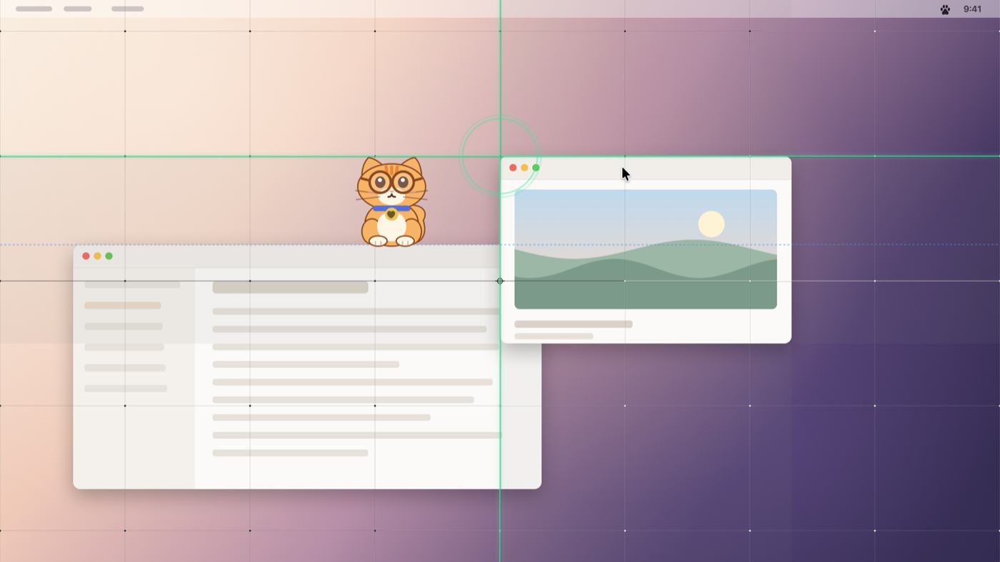
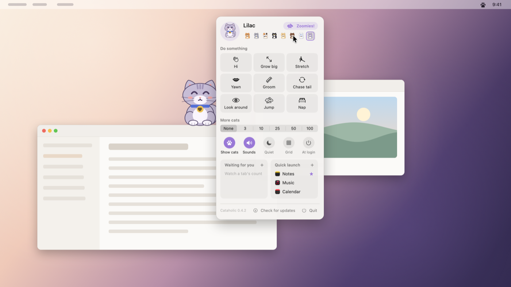

# Cataholic

A chunky cat (or a hundred) that lives on your Mac.





- **Eight coats** — Ginger (in reading glasses), Smokey, Patches, Tux, Butter, Cocoa, Snow, Lilac.
- **Gravity** — drag your cat off the menu bar and let go: it falls and lands on the Dock or the top of a
  window. Throw it and it flies. Move the window it's sitting on and it falls off.
- **Zoomies** — a leg-scramble start, a galloping run, hops, and skids that lean back.
- **The multiplier** — right-click → *More cats* → up to 100 cats raining onto your screen. They never block a
  click; only your own cat is pettable.
- **Pet it** — click for a purr and a happy squint.
- **On her own** — flip the switch beside *Do something* and your cat does it all by herself while you work: the emotes,
  walks, zoomies, and climbs up the side of a window. Point at her up there and she loses her grip. Off by default.
- **Find my cat** — double-click your cat and a little world opens with your cat hiding somewhere in it. Five levels,
  each harder: a kingdom by day; the kingdom again with lookalikes in your own coat, each with one detail wrong (the
  collar, the bell, the glasses, the ears, the tail tip, a spot); a harbour where only its ears peek out; a snowy village
  where pale coats vanish into the snow; and the kingdom at night, where your pointer is a lantern. Then it's endless.
  Three guesses a round — a miss leaves a paw print and says *warmer* or *colder* (or what gave a lookalike away); find
  it and it pops up waving and you go up a level; miss three times and the scene dims around where it was.
  Pinch (or ⌘+ / ⌘−, or the mouse wheel) to zoom in up to 3.5× and check a collar; drag or scroll to look around.
- **Updates itself** — checks once a day; a new version is downloaded, verified against the author's signing key and swapped in
  (the cat relaunches for a second). Right-click → *Check for updates…* to ask right now.
- **Signs** — any app or script can make your cat hold up a number, and it whispers when the number goes up:

  ```bash
  open "cataholic://sign?count=3&note=Build%20failed"   # hold up 3
  open "cataholic://sign?count=0"                         # put it down
  open "cataholic://zoomies"
  ```
- **Window grid** — right-click → turn on *Grid*. Drag any window (any app, even the Raycast bar) and a square grid
  fades in, built out from the centre of your screen and sized to its resolution. The lines take their colour from your
  wallpaper (dark over light patches, light over dark), the window casts a faint band across the screen on all four
  sides, and the edges of nearby windows show up as blue guides. Land an edge or the centre on a line and it glows
  mint, and a Force Touch trackpad gives a small tap. No permission needed.
  
- **One menu** — right-click the cat or click the paw: your cat and its coats up top, the emotes as a grid,
  and switches like Control Center. It takes its colour from the cat
  you pick — Ginger orange, Smokey slate, Patches terracotta, Tux blue, Butter gold, Cocoa brown, Snow ice blue, Lilac lavender.
  
- **Emotes that perform** — each one winds up, plays and settles: a mitten-paw wave, grooming with toe beans, a
  curled-up nap with drifting z's, and zoomies with dust, skids and a proud squint at the end.
- **Light as a feather** — at rest the cat is one still picture: ~0% CPU, ~30 MB. It only animates when it moves.
- Naps melted flat when you're away. Quiet mode and Reduce Motion calm everything down.

Cat sounds are CC0 / public-domain recordings — see `Resources/Sounds/CREDITS.md`.

## Install

1. Download `Cataholic-0.3.3.zip` from [Releases](../../releases), unzip it, and drag **Cataholic** into Applications.
2. Open it. It's signed and notarized by Apple, so it opens like any other app — and from here on it keeps itself up to date.
3. A paw appears in your menu bar and a cat in the top-right corner. Right-click the cat for everything.

Needs macOS 13 (Ventura) or later. Runs natively on Apple silicon and Intel.

## Build

```bash
./scripts/build.sh      # → dist/Cataholic.app (universal: Apple silicon + Intel), macOS 13+
```

No Xcode project — plain `swiftc`.
